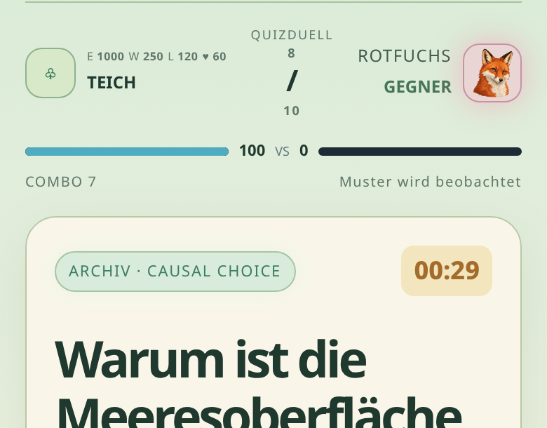
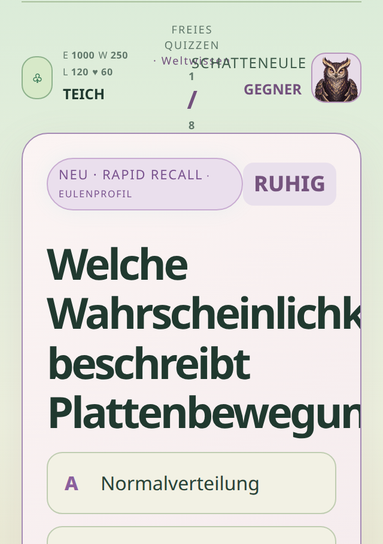
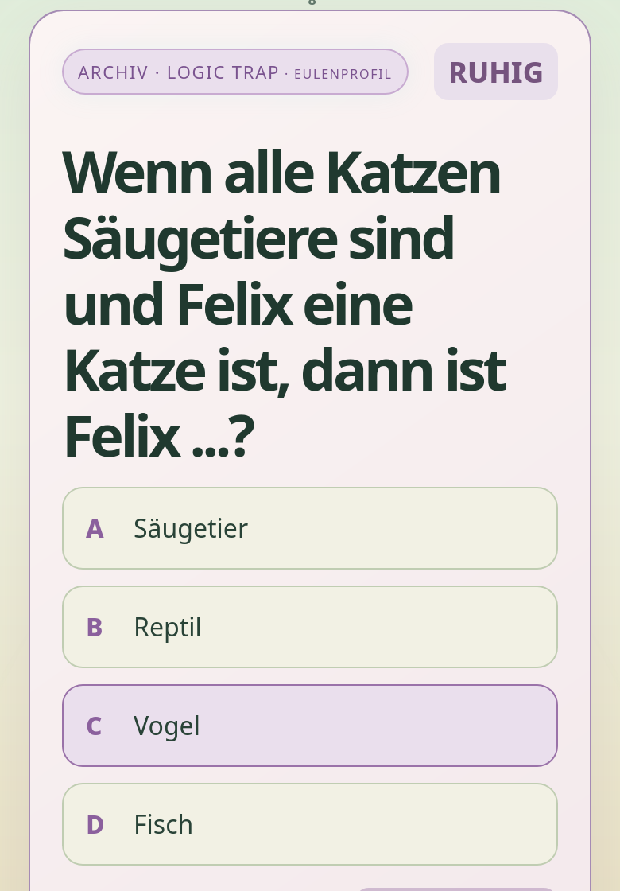
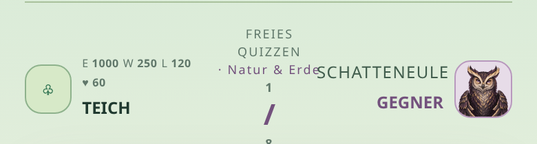

# pwnd – Testbericht Live-Spiel

> **Historischer Bericht:** Dieser Live-Test wurde am 2026-10-02 gegen Commit `6188851` des damaligen pwnd-Prototyps ausgeführt. Das Repository wurde seither umgebaut; zum Exportzeitpunkt ist `main` bei `8e31a74` und enthält `apps/pwnd/rebuild/`. Die Befunde und damaligen Codepfade sind nicht ungeprüft auf die aktuelle Implementierung übertragbar. Aktuellen Code und Tests vor Änderungen neu prüfen. Die eingebetteten Screenshots sind historische Belege.

**Getestet:** [app.manualai.org/pwnd](https://app.manualai.org/pwnd/) und [Online-Teich](https://app.manualai.org/pwnd/online.html), Stand Commit `6188851` (die Live-Dateien sind byte-identisch mit dem Repo)
**Datum:** 2. Oktober 2026
**Umfang:** freies Quiz, Fuchsduell, Teich/Bauen, Speichern, Fragen-API, Online-Teich, Layout (320/360/390/1280 px), Chromium und WebKit (Safari-Engine)

---

## Kurzfazit

Technisch läuft das Spiel stabil. In keinem Szenario gab es JavaScript-Fehler. Das Speichern ist robust, und der Teich rechnet korrekt. Alle vorhandenen Tests sind grün.

Die eigentlichen Probleme liegen in der **Spiellogik und der KI-Fragen-Pipeline**:

1. Das Duell endet nicht, wenn der Fuchs auf 0 HP ist.
2. Die Füchse stellen meist **Archivfragen statt KI-Fragen**.
3. Fragen **wiederholen sich** über mehrere Runden hinweg.
4. Energie ist gleichzeitig Währung und Elo-Wertung. Dadurch können **perfekte Siege Energie kosten**.
5. Das Upgrade „Libellenblick“ hat keine Wirkung.

---

## Übersicht der Befunde

| # | Priorität | Bereich | Befund | Aufwand Fix |
|---|---|---|---|---|
| H1 | Hoch | Duell | Duell läuft nach 0 HP des Fuchses weiter bis Runde 10 | klein |
| H2 | Hoch | Duell / KI | Nur 3 von 10 Duellfragen live per KI; Rest Archiv, nach 5–9 s Wartezeit | mittel |
| H3 | Hoch | Quiz / KI | Fragen wiederholen sich über Runden; ohne KI 8 von 8 identisch | mittel |
| H4 | Hoch | Ökonomie | Energie = Elo-Wertung: perfekter Sieg ab ca. 1.500 Energie gibt 0 oder Minus | mittel |
| H5 | Hoch | Upgrades | „Libellenblick“ wirkt nicht; zwei weitere Upgrade-Texte stimmen nicht | klein |
| M1 | Mittel | Layout | Lange Wörter in Fragen werden auf dem Handy abgeschnitten (bis 245 px) | klein |
| M2 | Mittel | Touch | „Phantom-Auswahl“: Eine Antwort sieht ausgewählt aus, ohne dass sie gewählt wurde | klein |
| M3 | Mittel | Layout | Kopfzeile im freien Quiz überlappt auf dem Handy | klein |
| M4 | Mittel | Tempo | Ø 6–7 s Wartezeit pro Frage; ca. 48 s pro Eulenquiz, ca. 69 s pro Duell | mittel |
| M5 | Mittel | Speichern / UX | Kein Abbrechen; Zurück-Wischen/Neuladen verwirft die Runde ohne Warnung | mittel |
| M6 | Mittel | KI-Kontingent | 40 KI-Fragen/Tag pro IP-Adresse; danach stilles Archiv (verstärkt H3) | klein |
| N1–N10 | Niedrig | Texte / Konsistenz | Grammatik, englische Labels, Symbole, Texte, favicon | klein |

---

## Hohe Priorität

### H1 – Duell endet nicht bei 0 HP

**Beobachtet (live):** Rotfuchs-Duell mit 10/10 richtigen Antworten. Nach **Runde 6** hatte der Fuchs **0 HP**. Die Runden 7–10 liefen trotzdem weiter, mit Meldungen wie „Du hast 22 Schaden verursacht“ gegen einen Fuchs mit 0 HP.



**Ursache:** `nextQuestion()` prüft nur `match.round >= match.total` und nie die HP (`pwnd.js`, Zeile 349). Das gilt auch, wenn der Spieler auf 0 fällt. Außerdem zählt ein HP-Gleichstand als Sieg (`aiHp <= playerHp`).

**Fix:** In `nextQuestion()` vor dem Rundenzähler `if (match.mode === 'duel' && (match.aiHp <= 0 || match.playerHp <= 0)) return finishMatch();` einfügen. Den K.-o.-Sieg im Endbildschirm benennen.

### H2 – Füchse stellen meist keine KI-Fragen

**Beobachtet:**

| Messung | KI-Frage | Archiv-Fallback |
|---|---|---|
| Live-Duell Rotfuchs (10 Runden) | 3 | 7 |
| Direkte API-Stichproben Duell (alle 3 Füchse) | 1 | 4 |
| Live freies Quiz „Natur & Erde“ (8 Runden) | 7 | 1 |
| Direkte API-Stichproben freies Quiz | 5 | 0 |

Im freien Quiz funktioniert die KI also fast immer, im Duell aber nur bei rund einem Viertel der Fragen. Dabei kommt der Archiv-Fallback im Duell erst nach **7–10 s**: Der Server wartet zuerst auf die gescheiterte KI-Antwort.

**Wahrscheinliche Ursache (Hypothese, Vercel-Logs waren nicht zugänglich):** Nur der Duell-Prompt in `api/pwnd-question.js` verlangt: „Analysiere die letzten Antworten … Trenne beobachtetes Antwortverhalten von Vermutungen“. Dazu fordert die Nutzernachricht „überprüfe Antwort und Erklärung vor dem Ausgeben“. Claude Haiku schreibt dann vermutlich Analysetext vor das JSON. `parseJson()` in `api/_lib.js` entfernt aber nur ```-Zäune. Dann scheitert `JSON.parse`, und es greift still der Fallback. Dazu passen die längeren Antwortzeiten im Duell.

**Fix:**

- JSON robust extrahieren (vom ersten `{` bis zur letzten `}`), oder per Assistant-Prefill `{` bzw. Tool-Use strukturiert erzwingen.
- Den Ablehnungsgrund loggen (parse / Validierung / Duplikat), um die Quote zu messen.
- In den Vercel-Logs nach `pwnd question generation failed` suchen; dort steht die konkrete Ursache.

### H3 – Fragen wiederholen sich über Runden hinweg

Die Startkarte verspricht „KI-Fragen … **ohne Wiederholung**“. Ausgeschlossen werden Fragen aber nur **innerhalb einer laufenden Runde** (`excludeIds`/`excludePrompts` aus `match.history`). Es gibt keine Liste bereits gesehener Fragen im Profil.

- **Ohne KI** (Kontingent aufgebraucht, API-Fehler): Zwei freie Quiz hintereinander zu „Natur & Erde“ lieferten **8 von 8 identische Fragen**, nur umsortiert. Pro Thema gibt es genau 8 Archivfragen, also eine Runde.
- **Mit KI:** Die KI landet immer wieder bei denselben Standardfragen. Die Frage „Hauptbestandteil der Erdatmosphäre / Stickstoff“ kam in **5 von 6** Starts zu „Natur & Erde“ (live und per API). Im Duell kam dieselbe Frage als Archivfrage in Runde 1.
- **Duplikaterkennung zu schwach:** `nearDuplicatePrompt()` erkennt Umformulierungen nicht. Alle drei getesteten Paare ergaben `false`, z. B. „Welcher Gasanteil macht den größten Teil der Erdatmosphäre aus?“ und „Welches Gas macht den größten Anteil der Erdatmosphäre aus?“. Damit ist eine sinngleiche Doppelung auch **innerhalb** einer Runde möglich, wenn KI- und Archivfragen gemischt werden.

**Fix:**

- Die letzten ca. 200 gesehenen Frage-IDs und Prompts im Profil speichern und an die API schicken. Server-seitig gilt aktuell ein Limit von 16 Ausschlüssen; das müsste steigen.
- Zusätzlich anhand der richtigen Antwort deduplizieren (gleiche Lösung + gleiche Kompetenz = Dublette).
- Das Archiv vergrößern und Ziehungen zufällig statt deterministisch nach Schwierigkeit machen.

### H4 – Energie ist Währung und Elo-Wertung zugleich

`calculateNewEnergy()` behandelt den Energiestand als Elo-Wertung gegen Fuchs-Ratings von 1000/1080/1160. Energie wird aber auch ausgegeben (Bauen, Freischalten) und produziert (Solar-Seerose bis 2.000).

Energieänderung nach einem Duell (K = 24, nach dem ersten Duell; berechnet mit der Spiel-Engine):

| Energiestand | Perfekter Sieg 10/10 | Knapper Sieg 6/10 | Niederlage 0/10 |
|---|---|---|---|
| 60 (nach Freischalten) | +22 | +17 | **+2** |
| 1.000 (Start) | +10 | +6 | −10 |
| 1.300 | +2 | **−3** | −18 |
| 1.500 | **0** | **−5** | −21 |
| 2.000 (Produktionsdeckel) | **−2** | **−6** | −22 |

Live bestätigt: Sieg 10/10 bei 1.000 Energie ergab +21 (erstes Duell, K = 48). Eine Niederlage 0/10 ergab −15.

Folgen: Wer seinen Teich ausbaut und viel Energie produziert, verliert durch Siege Energie. Wer Energie ausgibt, bekommt sie sogar bei einer 0/10-Niederlage dazu.

**Fix:** Eine getrennte, versteckte Wertung (`rating`) für Matchmaking/Elo führen. Die Energie-Belohnung daraus ableiten, mit einer Untergrenze ≥ 0 für Siege.

### H5 – Upgrades

| Upgrade | Text im Spiel | Tatsächliches Verhalten |
|---|---|---|
| LIBELLENBLICK | „Einmal pro Match eine Antwortoption entfernen.“ | **Keine Wirkung.** `mods.scanner` wird gesetzt, aber nirgends gelesen; es gibt keinen Knopf. Getestet: 4 Optionen, keine Entfernung. |
| KLARES WASSER | „+2 Sekunden bei schnellen Abruffragen.“ | +2 s bei **allen** Fragetypen |
| RUHIGE BUCHT | „**Eine** falsche Antwort pro Match verliert nur einen Combo-Punkt.“ | gilt bei **jeder** falschen Antwort |

Außerdem steht dort „Wähle eine Anpassung für dein **nächstes** Quizduell“, die Wahl gilt aber dauerhaft (rollierend bis zu 3). Aktive Upgrades werden nirgends angezeigt. Die Upgrade-Auswahl erscheint auch nach dem freien Quiz, unter der Überschrift „Wie soll dein Teich weiterwachsen?“, obwohl die Upgrades nur das Duell betreffen.

---

## Mittlere Priorität

### M1 – Lange Wörter in Fragen werden abgeschnitten

Die Fragenüberschrift wird mit **36 px** dargestellt: Die Regel `.screen h2 { font-size: 36px }` überschreibt das vorgesehene `clamp(21px, 5vw, 30px)` von `.question-card h2`. Silbentrennung gibt es nicht. Deutsche Komposita laufen aus der Karte: bei 390 px um 175 px, bei 360 px um 205 px, bei 320 px um 245 px. Live beobachtet wurden „Wahrscheinlichkei…“ und „Plattenbewegunge…“.



**Fix:** `#questionTitle { font-size: clamp(22px, 6.4vw, 32px); hyphens: auto; overflow-wrap: anywhere; }` (`lang="de"` ist bereits gesetzt).

### M2 – Phantom-Auswahl auf Touch-Geräten

`.answer:hover` und `.answer.selected` haben exakt denselben Stil, und es gibt keine `@media (hover: hover)`-Abgrenzung. Auf Handys bleibt nach einem Tipp der Hover-Zustand an der Antwort „kleben“, die an der Stelle des letzten Tipps erscheint (z. B. unter „LOS!“ oder „Nächste Runde“). Sie **sieht dann ausgewählt aus**, obwohl nichts gewählt ist und „Antwort abgeben“ noch deaktiviert ist. Das ist in WebKit (Safari-Engine) und in Chromium-Mobile reproduzierbar.



**Fix:** Hover-Stile in `@media (hover: hover) { … }` verschieben und `.selected` deutlicher machen (z. B. Häkchen oder kräftigerer Rand).

### M3 – Kopfzeile im freien Quiz überlappt

Auf 320–390 px kollidiert das Thema mit dem Gegnernamen, z. B. „· Natur & Erde**SCHATTENEULE**“ oder „· Klar denken**SCHATTENEULE**“. Längere Themen werden gekürzt („Risiko & Entsc…“). Der Rundenzähler steht senkrecht gestapelt (1 / Strich / 8).



**Fix:** Das Thema in eine eigene Zeile unter der Kopfzeile setzen und den Zähler als `1/8` inline darstellen.

### M4 – Wartezeit pro Frage

| Modus | Ø Wartezeit | Spanne | Summe pro Runde |
|---|---|---|---|
| Freies Quiz (8 Fragen) | 6,0 s | 5,3–7,1 s | ca. 48 s |
| Duell (10 Fragen) | 6,9 s | 4,8–9,2 s | ca. 69 s |

Darin enthalten ist eine feste Pause von 1,1 s pro Frage. Bei einem API-Ausfall wartet der Client bis zu 15 s (Timeout) und danach weitere 1,1 s.

**Fix:** Die nächste Frage schon **vorab laden**, während der Spieler das Rundenergebnis und die Erklärung liest. Die Wartezeit fällt dann praktisch weg.

### M5 – Kein Abbrechen, Runde geht still verloren

- Während einer Quizrunde gibt es keinen „Aufgeben/Zurück“-Knopf.
- Zurück-Wischen bzw. die Browser-Zurück-Taste verlässt das Spiel sofort (getestet: Weiterleitung auf `app.manualai.org/`). Die Runde ist ohne Rückfrage verloren.
- Auch Neuladen mitten in der Runde führt ohne Hinweis zurück zum Teich. Belohnungen gibt es keine, das Skillprofil wurde aber schon gespeichert.
- **Exploit:** Wer im Duell verliert, lädt vor der letzten Antwort neu und vermeidet so den Energieverlust.

**Fix:** Einen Aufgeben-Knopf mit Bestätigung einbauen, dazu `history.pushState` und `beforeunload` während einer Runde. Für spätere PvP-/Server-Versionen einen abgebrochenen Duellversuch als Niederlage werten.

### M6 – KI-Kontingent pro IP-Adresse

Die API erlaubt **40 KI-Fragen pro Tag und IP-Adresse**. Das sind etwa 2 Duelle und 2 freie Quiz. Global gilt ein Limit von 1.000 Fragen pro Tag (`PWND_QUESTION_DAILY_LIMIT` / `…_GLOBAL_LIMIT`). Danach kommen still nur Archivfragen; erkennbar ist das nur am Label „ARCHIV“. Alle Geräte hinter einer IP (Familien-WLAN, Schule) teilen sich die 40 Fragen. Zusammen mit H3 führt das schnell zu Wiederholungen.

---

## Niedrige Priorität (Texte und Konsistenz)

| # | Befund | Stelle |
|---|---|---|
| N1 | Grammatik: „prüft weiter **deine Abruf**“ (live gesehen). Ebenso falsch wären „deine Muster / Quellengefühl / Risiko“. | `adaptiveComment()` mit `SKILL_NAMES` |
| N2 | Eulenkommentar und Kopfzeile widersprechen sich: Kommentar „prüft weiter deine Kausalität“, gleichzeitig Kopfzeile „Abruf wird beobachtet“. Zwei Funktionen berechnen die Schwäche unterschiedlich. | `adaptiveComment()` vs. `renderBattle()` |
| N3 | Nach falscher Antwort im freien Quiz: „Versuch es gleich erneut“. Die nächste Frage ist aber eine andere. | `showRoundResult()` |
| N4 | Endtext bei Niederlage 0/10 und −15 Energie: „Dein Duell hat deine vier Reserven **gestärkt**.“ | `finishMatch()` |
| N5 | Englische Labels in einem deutschen Spiel: RAPID RECALL, LOGIC TRAP, CAUSAL CHOICE, SOURCE SENSE, PATTERN RECOGNITION, AGENT DECISION, „· EULENPROFIL“; HTML-Platzhalter „ANALYZING YOUR PATTERN…“, „ROUND RESULT“. „RAPID RECALL“ widerspricht im freien Quiz „ohne Zeitdruck“. | `TYPE_NAMES`, `index.html` |
| N6 | Drei verschiedene Ressourcen-Symbolsätze: Startkarten ϟ ≈ ⌁ ♥, Bauen/Wachstumskarte ⚡ 💧 🌬️ ❤️, Kampf-Kopfzeile Buchstaben „E W L ♥“ | `index.html`, `pwnd.js` |
| N7 | Großes „+“/„ד und „+1 Wissen“ auf dem Ergebnisbildschirm. Wissen ist keine Währung (bereits im Chat erkannt, noch offen). | `showRoundResult()` |
| N8 | Die KI-Erklärung enthielt einmal einen Meta-Satz aus dem Prompt: „Dies ist eine überprüfbare naturwissenschaftliche Tatsache.“ | Prompt in `api/pwnd-question.js` |
| N9 | `favicon.ico` fehlt; jeder Seitenaufruf erzeugt einen 404 in der Konsole. | Projektwurzel |
| N10 | Nach dem Bauen springt die Seite nach oben zur Teich-Animation. Fürs nächste Gebäude muss man wieder zum Raster scrollen. | `placeChoiceAt()` |

---

## Was gut funktioniert

- **Stabilität:** In keinem Szenario gab es JavaScript-Fehler, weder in Chromium noch in WebKit. Bei 320, 360, 390 und 1280 px gibt es keinen horizontalen Seiten-Scroll.
- **Speichern:**
  - Belohnungen bleiben nach dem Neuladen erhalten (freies Quiz, Duell, Bauen, Abholen).
  - Ein Quizversuch wird nur einmal gutgeschrieben.
  - Ein beschädigter Spielstand wird gesichert und mit Hinweis ersetzt.
  - Ist der Speicher blockiert, erscheint eine Warnung.
  - Ändert ein zweiter Tab den Spielstand, wird das erkannt und das Überschreiben verhindert.
- **Teich:**
  - Alle drei Gebäude lassen sich bauen; die goldenen Felder stimmen (12 Bonusfelder je Gebäude).
  - Beide Boni wirken (+300 Energie bzw. +120 Luft pro Stunde).
  - 3 h simulierte Offline-Zeit ergaben exakt +800 ⚡ (am 2.000-Deckel gekappt), +360 💧 und +720 🌬️.
  - Der 8-h-Deckel greift (960 💧).
  - Beim Umsetzen bleibt die erarbeitete Produktion erhalten; Freischalten (Schilfgürtel) und Speichern funktionieren.
- **API-Ausfälle:** Bei 429, Netzwerkfehler und Timeout springt das Spiel sauber auf Archivfragen um und bleibt nie hängen. Die API lehnt GET (405) und ungültige Eingaben (400) korrekt ab.
- **Freies Quiz mit KI:** 7 von 8 Fragen kamen live per KI, alle passend zum Thema, mit nachvollziehbaren Erklärungen.
- **Online-Teich:** Der vorhandene Browsertest mit simulierter Anmeldung ist **gegen live grün**, und die Anmeldeseite lädt ohne Fehler. Die echte E-Mail-Anmeldung habe ich bewusst nicht getestet, um kein echtes Konto und keine Serverdaten anzulegen. Das kannst nur du selbst prüfen.
- **Vorhandene Tests:** `npm run test:pwnd` sowie `pond-browser`, `owl-entry`, `fox-thinking` und `online-browser` (lokal und live) sind alle grün.

---

## Empfohlene Reihenfolge

1. **H1 und H5 (Libellenblick)**: wenige Zeilen, große Wirkung aufs Spielgefühl
2. **M1, M2, M3**: reine CSS-Korrekturen für Handys
3. **H2**: robustes JSON-Parsing und Logging in der Fragen-API, Ursache in den Vercel-Logs bestätigen
4. **H3 und M4**: gesehene Fragen im Profil speichern, nächste Frage vorab laden
5. **H4**: Elo-Wertung von der Energie trennen (wichtig vor der Integration ins Hauptspiel)
6. **M5, M6 und N1–N10**: Abbrechen-Fluss, Kontingent-Hinweis und Texte

---

## Testmethodik

| Szenario | Art | Ergebnis |
|---|---|---|
| Freies Quiz, 8 Runden, gemischt richtig/falsch, Neuladen | live, echte KI | Belohnungen gespeichert, Befunde H3, M3, M4, N1–N3 |
| Duell Rotfuchs, 10/10 richtig, Neuladen | live, echte KI | Befunde H1, H2 |
| Duell Polarfuchs, Zeitablauf und 0/10 | Fragen simuliert | Zeitablauf korrekt (15 s, −7 Ausdauer), Befund N4 |
| Upgrades Libellenblick, Ruhige Bucht, Klares Wasser | Fragen simuliert | Befund H5 |
| Teich: Bauen, Boni, 3 h / 20 h offline, Abholen, Umsetzen, Freischalten | live, Zeit simuliert | korrekt |
| Neuladen mitten in der Runde, Zurück-Taste, kaputter Spielstand, blockierter Speicher, zwei Tabs | live | Befund M5; Schutzmechanismen ok |
| API: 429, Netzwerkfehler, über 15 s langsam | simuliert | Fallback ok |
| Wiederholung: 2 × gleiches Thema ohne KI | simuliert (429) | 8 von 8 wiederholt |
| Layout 320/360/390/1280 px | live | Befunde M1, M3 |
| WebKit (Safari-Engine) komplette Eulenrunde | live, Fragen simuliert | läuft fehlerfrei; Befund M2 |
| Online-Teich: vorhandener Test, anonyme Ansicht | live, Anmeldung simuliert | grün |

Hinweise:

- „Fragen simuliert“ heißt: Die Fragen-API wurde im Testbrowser abgefangen und aus dem vorhandenen Fragenarchiv beantwortet, um das KI-Kontingent zu schonen. Die Spiel-Logik lief dabei unverändert live.
- Insgesamt wurden ca. 28 echte KI-Fragen erzeugt; sie zählen auf das Kontingent der Test-IP, nicht auf deines.
- Es wurden keine Serverdaten geschrieben und keine Konten angelegt.
